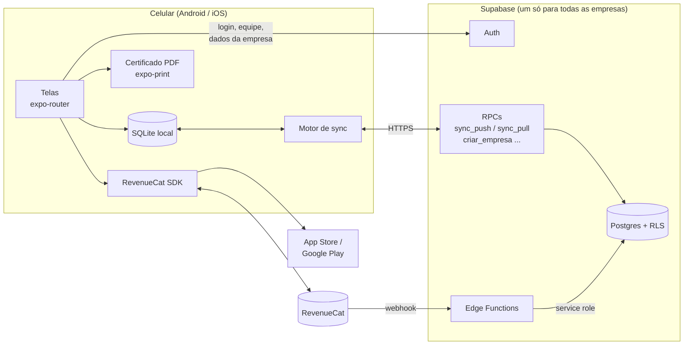

# Documentação do EasyOS Light

App de ordens de serviço para **empresas de controle de pragas** (dedetizadoras),
vendido como **assinatura nas lojas** (App Store / Google Play). Cada empresa cria sua
conta, convida os técnicos e trabalha com clientes, agenda, atendimento em campo e
**certificado de execução em PDF**. Tudo funciona **offline** e sincroniza quando a
internet volta.

## Índice

| Documento | Para que serve |
|---|---|
| [arquitetura.md](arquitetura.md) | Como o sistema é montado: camadas, multi-empresa, banco local, sincronização, segurança, assinatura |
| [dominios.md](dominios.md) | Entidades do negócio, campos, relacionamentos, ciclo de vida da OS e regras de cada domínio |
| [funcionalidades.md](funcionalidades.md) | O que o app faz, tela por tela, e o que cada papel pode fazer |
| [decisoes.md](decisoes.md) | Por que as coisas são como são: uma linha por decisão |

## Visão em uma página



## Stack

| Camada | Tecnologia |
|---|---|
| App Android/iOS | React Native 0.86 + Expo SDK 57, expo-router, TypeScript estrito |
| Banco no aparelho | SQLite (`expo-sqlite`) |
| Backend | Supabase: Postgres + Auth + RLS + Edge Functions (Deno) |
| Assinatura | RevenueCat (`react-native-purchases`) |
| Certificado | HTML → PDF no aparelho (`expo-print` + `expo-sharing`) |
| Build | EAS Build (nuvem) ou Gradle local (`app/android`, gerado por `expo prebuild`) |

## Estrutura do repositório

```
app/                       aplicativo Expo
  app/                     telas (cada arquivo é uma rota do expo-router)
    (tabs)/                abas: Agenda, Clientes, Ajustes
    os/ cliente/ local/    telas de cada domínio
    catalogo/              produtos, serviços e pragas
  src/
    db/                    schema local, acesso ao SQLite, consultas (repos.ts)
    sync/                  motor de sincronização
    auth/                  sessão, perfil, empresa, papel
    assinatura/            RevenueCat e regra de bloqueio
    catalogo/              definição dos formulários de catálogo
    certificado/           HTML/PDF do certificado
    components/            componentes de UI compartilhados
    lib/                   cliente Supabase, formatação, tema, uuid
supabase/
  migrations/              SQL versionado (schema, RLS, sync, onboarding, OS reatribuída)
  functions/               revenuecat-webhook, verificar-assinatura, excluir-conta
  tests/                   cenários SQL + rodar.sh (Postgres no Docker)
.doc/                      esta documentação
```

## Estado atual (outubro/2026)

- **Banco:** schema multi-empresa, RLS, sync e onboarding aplicados no Supabase.
- **App:** passa na checagem de tipos e no `expo-doctor`; APK de teste gerado
  (EAS e local). **Ainda não foi validado em aparelho.**
- **Edge Functions:** escritas, não testadas contra o RevenueCat real.
- **Lojas e RevenueCat:** não configurados, então as compras não funcionam ainda.
- **Testes SQL:** `bash supabase/tests/rodar.sh` (Docker). Por enquanto cobre o
  cenário de OS reatribuída.
- **Faltando:** recuperação de senha, fotos do atendimento, GPS, painel web.
