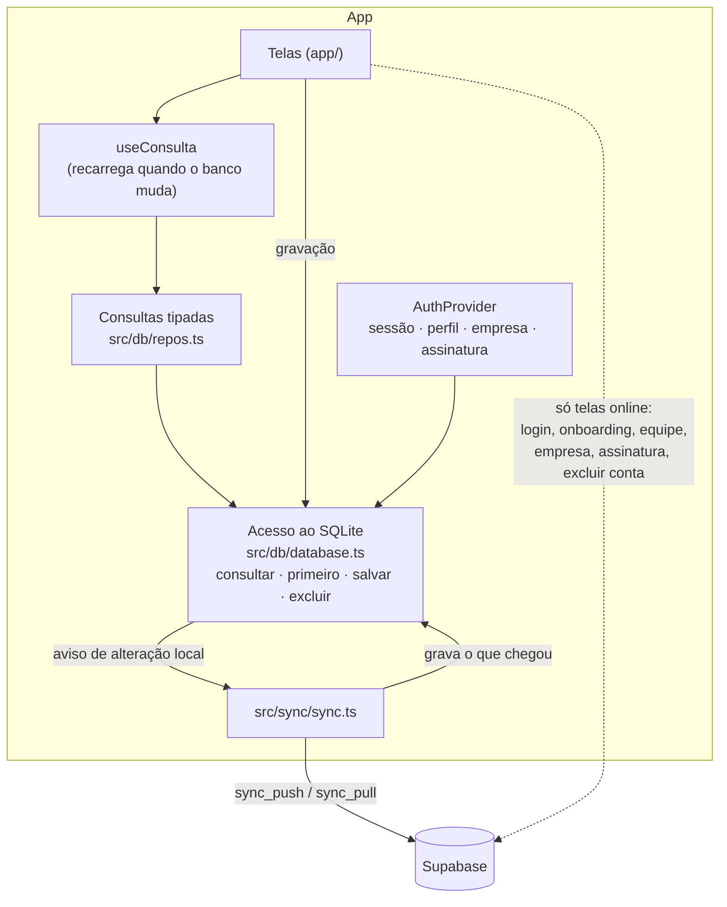
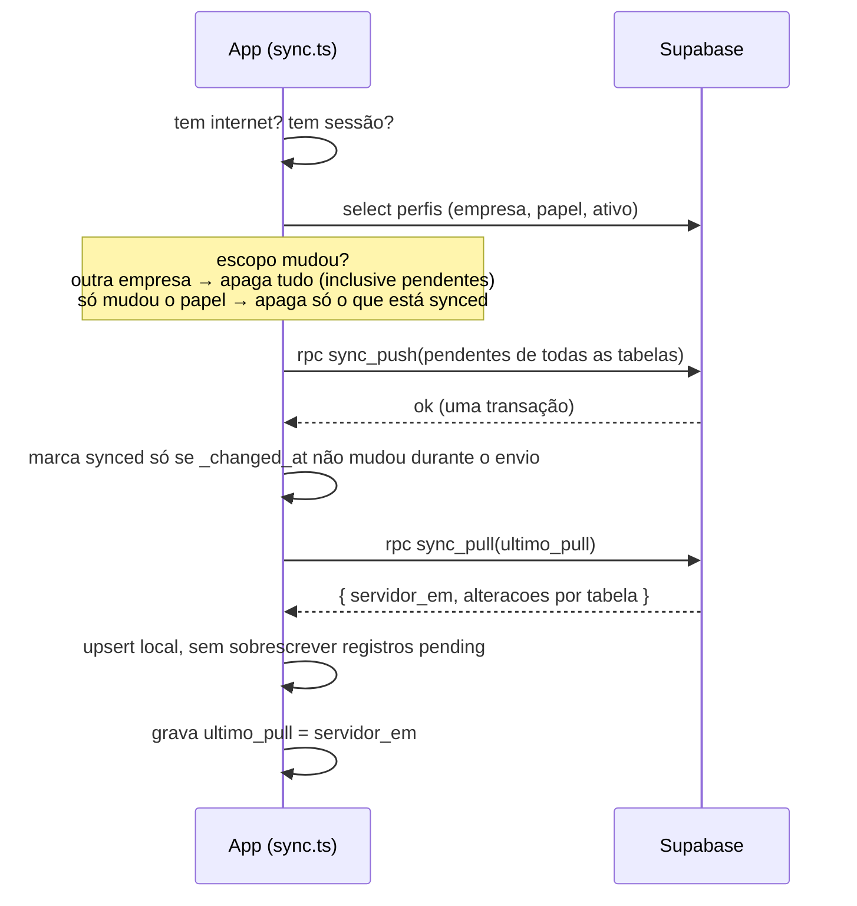
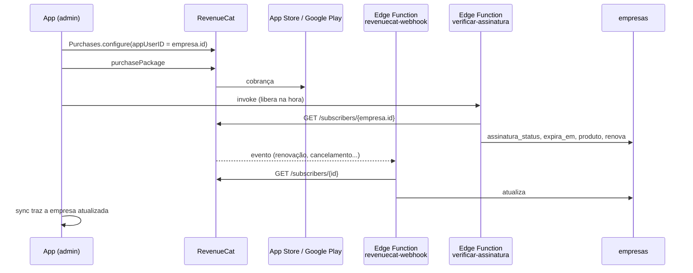

# Arquitetura

## 1. Princípios

1. **Offline primeiro.** As telas de operação só leem e gravam no SQLite do aparelho.
   A rede nunca bloqueia o técnico em campo.
2. **Um backend para todas as empresas.** Um único Supabase. O isolamento entre
   empresas é feito no banco (RLS + triggers), não no app.
3. **O servidor é a autoridade** sobre o que não pode ser forjado: empresa do registro,
   papel do usuário, horário de alteração, número da OS e situação da assinatura.
4. **Nada é apagado de verdade.** Exclusão é lógica (`deleted = true`) para que a
   exclusão também sincronize. Falta de pagamento nunca apaga dados.

## 2. Camadas

| Peça | Arquivo | Responsabilidade |
|---|---|---|
| Layout raiz | `app/app/_layout.tsx` | Abre o SQLite, monta `AuthProvider`, liga a sync automática e declara as rotas |
| Guarda das abas | `app/app/(tabs)/_layout.tsx` | Redireciona: sem sessão → login; sem empresa → onboarding; assinatura vencida → assinatura |
| Schema local | `src/db/schema.ts` | Lista de tabelas/colunas espelhadas, ordem de envio, colunas booleanas e de data |
| Banco local | `src/db/database.ts` | Cria tabelas, "migração" automática de colunas, `salvar`/`excluir`, eventos de mudança |
| Consultas | `src/db/repos.ts` | Todas as leituras das telas, com tipos de retorno |
| Sync | `src/sync/sync.ts` | Push, pull, verificação de escopo, gatilhos automáticos, estado para a UI |
| Auth | `src/auth/AuthProvider.tsx` | Login, cadastro, sair; expõe perfil, empresa, papel e situação da assinatura |
| Assinatura | `src/assinatura/` | SDK do RevenueCat e regra de bloqueio no aparelho |
| Certificado | `src/certificado/certificado.ts` | Monta o HTML e gera o PDF no aparelho |

## 3. Multi-empresa (isolamento)

Toda tabela de negócio tem `empresa_id`. O isolamento acontece em quatro camadas no
Postgres:

| Mecanismo | O que garante |
|---|---|
| `empresa_atual()` | Devolve a empresa do usuário logado a partir de `perfis` (só se ativo e não excluído) |
| Trigger `b_set_empresa` | Preenche `empresa_id` no insert com a empresa do usuário e impede trocar depois. **O app nunca envia `empresa_id`** |
| RLS | Toda política filtra por `empresa_id = empresa_atual()`; escrita exige `pode_escrever()` |
| Trigger `d_valida_referencias` | Impede referência cruzada (ex.: OS da empresa A apontando para cliente da B) |

Outras proteções:

- `anon` não tem acesso a nenhuma tabela.
- `delete` físico revogado de `authenticated`.
- Em `empresas`, o usuário só pode alterar os campos cadastrais (grant por coluna). Os
  campos de assinatura só mudam pela service role (Edge Functions).
- Em `perfis`, só `nome`, `telefone`, `papel` e `ativo`, e só pelo admin da mesma
  empresa.

### Ordem dos triggers

Os triggers `before` disparam em ordem alfabética, por isso os prefixos:

1. `a_set_updated_at`: `updated_at` = relógio do servidor
2. `b_set_empresa`: define `empresa_id`
3. `c_numero_os` (só OS): número sequencial por empresa, travando a linha da empresa
4. `d_valida_referencias`: confere que as chaves estrangeiras são da mesma empresa

### Funções de permissão

| Função | Retorno |
|---|---|
| `papel_atual()` | `admin` / `atendente` / `tecnico`, ou nulo se sem empresa ativa |
| `eh_equipe_interna()` | `true` para admin e atendente |
| `assinatura_ok()` | Teste vigente **ou** assinatura vencida há menos de 3 dias |
| `pode_escrever()` | Tem papel **e** assinatura ok |
| `pode_acessar_os(os_id)` | OS da empresa e (equipe interna **ou** técnico da OS) |

## 4. Banco local (SQLite)

- Um arquivo `easyos.db` por aparelho, com **os dados de um usuário só**. Ao trocar de
  usuário, o banco é limpo.
- As tabelas locais espelham as do servidor, **sem `empresa_id`** (o aparelho só tem
  uma empresa).
- Cada tabela tem duas colunas de controle:
  - `_status`: `synced` ou `pending` (alterado no aparelho e ainda não enviado)
  - `_changed_at`: horário da última alteração local
- Tabela `meta` (chave/valor) guarda `usuario_id`, `escopo` (empresa|papel),
  `ultimo_pull` e `ultima_sync`.
- **Migração automática:** ao abrir, para cada coluna em `TABELAS` que não existe no
  aparelho, roda `alter table ... add column`. Coluna nova só precisa ser declarada em
  `schema.ts`.
- IDs são UUID gerados no aparelho (`novoId()`), o que permite criar registros offline.
- Booleanos ficam como 0/1 e datas como ISO UTC (`...Z`), para comparar como texto.

### Gravação

`salvar(tabela, dados)` faz insert ou update conforme o `id` exista, marca
`_status = 'pending'`, avisa as telas (`notificarMudanca`) e agenda uma sync em 3 s.
`excluir(tabela, id)` é `salvar` com `deleted = 1`.

### Leitura reativa

`useConsulta(fn, deps)` roda a consulta e refaz quando:
o banco muda (edição local ou dados que chegaram na sync), a tela ganha foco ou
os `deps` mudam.

## 5. Sincronização

### Push (`sync_push`)

- Recebe um JSON `{ tabela: [linhas] }` e grava tudo **numa transação**.
- Ordem fixa por causa das chaves estrangeiras: pragas → produtos → serviços →
  clientes → locais → ordens_servico → os_pragas → os_produtos.
- Ignora colunas que são do servidor: `updated_at`, `numero`, `empresa_id`.
  Preserva `id`, `created_at` e `created_by` de registros existentes.
- Faz **update e depois insert** (não `ON CONFLICT`), para não "queimar" números de OS.
- Roda como `security invoker`: o RLS do usuário continua valendo.
- Recusa com `SEM_EMPRESA` ou `ASSINATURA_INATIVA` quando for o caso.

### Pull (`sync_pull`)

- Devolve, por tabela, tudo com `updated_at` maior que o último pull **menos 5
  minutos** (janela para transações que confirmaram depois). O upsert local é
  idempotente.
- A primeira carga não traz registros excluídos.
- Também é `security invoker`: cada aparelho só recebe o que o RLS deixa ver (o
  técnico recebe só as próprias OS).
- Devolve também `removidas.ordens_servico`: ids de OS da empresa que mudaram e que o
  usuário **não pode mais ver** (ex.: reatribuídas a outro técnico). O app apaga essas
  OS e seus itens do aparelho, inclusive alterações pendentes, que o servidor recusaria.
  Para a equipe interna a lista é sempre vazia.
- Ao trocar o técnico de uma OS, o trigger `e_os_tecnico_trocado` dá `updated_at` novo
  aos itens dela, para que o técnico novo receba pragas e produtos já registrados.

### Gatilhos

| Quando | Como |
|---|---|
| App abre / login | `iniciarSyncAutomatico()` e `sincronizar()` após `entrar` |
| 3 s após cada alteração local | debounce em `registrarAoAlterarLocal` |
| Internet volta | `NetInfo.addEventListener` |
| App volta ao primeiro plano | `AppState` |
| A cada 5 min | `setInterval` |
| Manual | Banner de sync ou Ajustes → "Sincronizar agora" |

Se o push falhar (ex.: assinatura vencida), o pull roda mesmo assim, para trazer uma
renovação feita em outro aparelho.

### Conflitos

**A última gravação vence** (last-write-wins). No aparelho, um registro `pending`
nunca é sobrescrito pelo pull. Ele vai para o servidor no próximo push e sobrescreve o
que estiver lá.

### O que precisa de internet

Login/cadastro, criar ou entrar em empresa, equipe, dados da empresa, assinatura e
excluir conta. Essas telas chamam o Supabase direto e depois disparam uma sync. Todo o
resto (clientes, endereços, agenda, atendimento, catálogos, certificado) funciona
offline.

## 6. Autenticação e escopo

1. Cadastro pelo Supabase Auth (e-mail + senha). O trigger `handle_new_user` cria o
   `perfil` com papel `tecnico` e sem empresa.
2. O usuário cria uma empresa (`criar_empresa`, vira admin) ou entra com convite
   (`entrar_empresa`, entra como técnico). **O papel nunca vem do app.**
3. A sessão fica salva no aparelho (AsyncStorage): o app abre logado mesmo offline.
4. Perfil e empresa que a UI usa vêm do **SQLite** (chegam pela sync), por isso
   funcionam offline.
5. Ao sair: se há pendentes, o app avisa que serão perdidos. Ao confirmar, faz logout
   local e limpa o banco.

## 7. Assinatura

- **A assinatura é da empresa:** o App User ID no RevenueCat é `empresas.id`. Uma
  compra libera todos os usuários. Só o admin compra. Entitlement: `pro`.
- O webhook não confia no conteúdo do evento: sempre consulta o estado atual na API do
  RevenueCat.
- Empresa nova ganha **14 dias de teste** (`trial_ate`).

### Bloqueio

| Onde | Tolerância após vencer | Efeito |
|---|---|---|
| Servidor (`assinatura_ok`) | 3 dias | `sync_push` e RLS recusam gravações |
| Aparelho (`situacao.ts`) | 7 dias | Depois disso, redireciona para a tela de assinatura |

A tolerância do aparelho é maior porque o técnico pode estar offline sem saber da
renovação. O que ele registrar nesse período fica pendente e sobe quando a assinatura
for confirmada.

## 8. Edge Functions

| Função | Autenticação | O que faz |
|---|---|---|
| `revenuecat-webhook` | Header `Authorization: Bearer <REVENUECAT_WEBHOOK_SECRET>` (deploy com `--no-verify-jwt`) | Recebe evento do RevenueCat e sincroniza a assinatura de cada ID que pareça uma empresa |
| `verificar-assinatura` | JWT do usuário | Chamada logo após compra/restauração para liberar na hora |
| `excluir-conta` | JWT do usuário | Exclui o usuário. Bloqueia se for o único admin com equipe ativa. Se for o único usuário, desativa a empresa |

Segredos (`supabase secrets`): `REVENUECAT_SECRET_KEY`, `REVENUECAT_ENTITLEMENT`,
`REVENUECAT_WEBHOOK_SECRET`. A service role só existe nas funções, nunca no app.

## 9. Certificado

Gerado **no aparelho** a partir do SQLite: HTML → PDF (`expo-print`), depois a folha
de compartilhamento (WhatsApp, e-mail...). Funciona offline.

- Código de verificação: `EOL-` + 10 primeiros caracteres hex do id da OS. É gerado
  offline e gravado na conclusão.
- Campos baseados na RDC 622/2022 da ANVISA (detalhes em
  [dominios.md](dominios.md#certificado)). **Mudança nos campos precisa de conferência
  de um responsável técnico.**

## 10. Configuração e build

Variáveis do app (`app/.env`, só chaves públicas `EXPO_PUBLIC_*`):

| Variável | Uso |
|---|---|
| `EXPO_PUBLIC_SUPABASE_URL` / `EXPO_PUBLIC_SUPABASE_KEY` | Cliente Supabase (chave publishable/anon). Sem elas o app não abre |
| `EXPO_PUBLIC_REVENUECAT_IOS_KEY` / `_ANDROID_KEY` | Compras. Sem elas a tela de assinatura avisa que não há compras configuradas |
| `EXPO_PUBLIC_URL_TERMOS` / `_PRIVACIDADE` | Links obrigatórios na tela de assinatura |

As mesmas variáveis estão cadastradas no **EAS** (ambientes `development`, `preview`,
`production`), porque o `.env` não sobe para o build na nuvem.

| Perfil EAS | Saída |
|---|---|
| `development` | Development build (necessário para testar compras) |
| `preview` | **APK** para instalar direto no celular |
| `production` | AAB/IPA para as lojas, com `versionCode` incrementado automaticamente |

Build local Android: `npx expo prebuild -p android` e depois
`./gradlew.bat assembleRelease` em `app/android`, usando o JDK 17 do Android Studio. A
pasta `android/` é gerada e fica fora do git.

## 11. Limitações conhecidas

- **OS reatribuída com edição pendente:** se o técnico antigo editou a OS offline
  antes de saber da troca, essa edição é descartada no aparelho dele. O servidor não a
  aceitaria, porque a OS não é mais dele.
- **Assinatura do cliente** é um PNG em base64 dentro da própria OS. Funciona, mas
  aumenta o tamanho do push/pull. As fotos, quando existirem, devem ir para o Storage.
- **Last-write-wins** pode perder uma edição simultânea do mesmo campo em dois
  aparelhos. Qualquer outra estratégia precisa ser registrada em `docs/decisoes.md`.
- **Testes SQL:** existe só o cenário de OS reatribuída (`supabase/tests/`). Faltam
  cenários para o schema e o RLS originais (migrations 001–004).

## 12. Testes SQL

`bash supabase/tests/rodar.sh` sobe um Postgres 16 descartável no Docker e roda:

1. `00_ambiente_supabase.sql`: simula o que o Supabase traz (papéis `anon` e
   `authenticated`, `auth.users`, `auth.uid()`) e os utilitários `teste.como(usuario)`
   e `teste.confere(condição, mensagem)`;
2. todas as migrations, em ordem;
3. os cenários `NN_*.sql`, que param no primeiro `FALHOU`.
