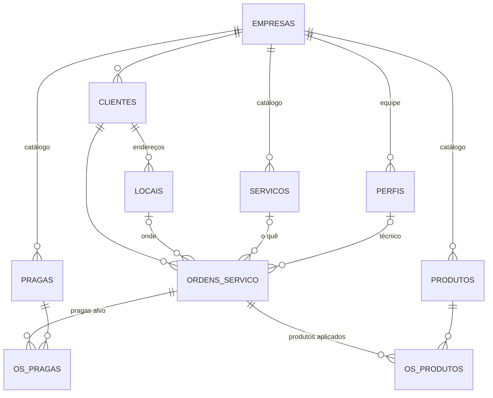
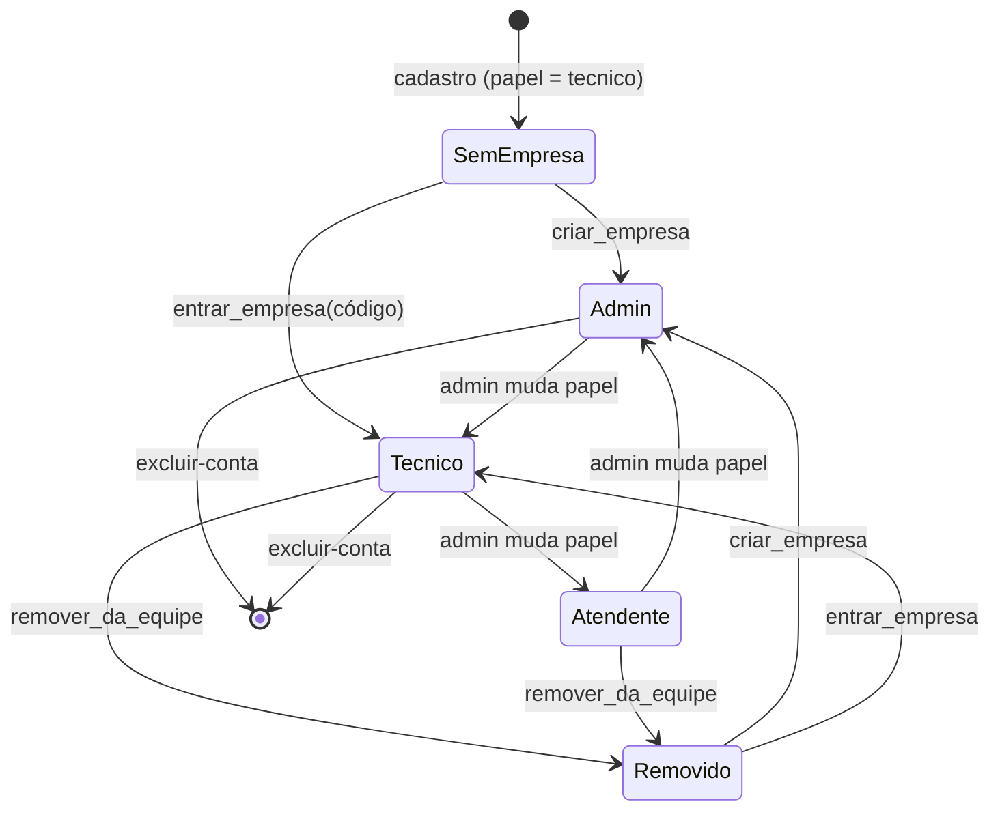
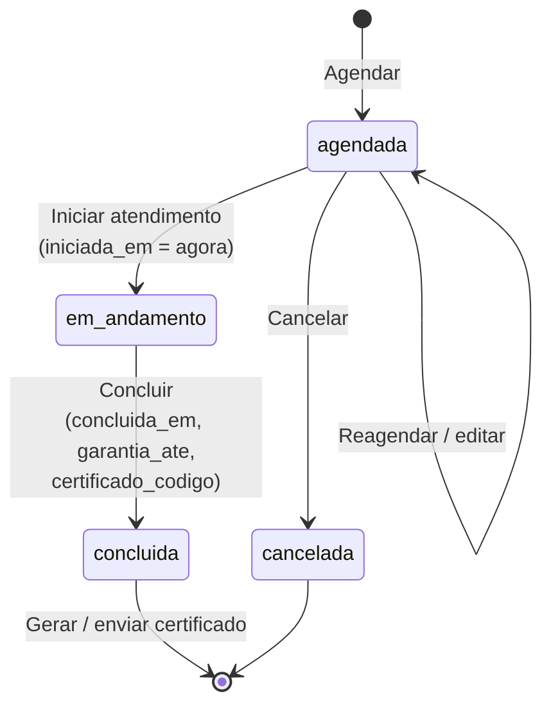

# Domínios

O sistema é dividido em seis domínios. Todos (exceto Identidade) pertencem a uma
**empresa** e são isolados por ela.

Colunas comuns a todas as tabelas: `id` (uuid), `empresa_id` (preenchido pelo
servidor), `created_at`, `updated_at` (relógio do servidor) e `deleted` (exclusão
lógica).

---

## 1. Empresa (tenant)

**Tabela:** `empresas`. É o cliente pagante do SaaS (a dedetizadora).

| Grupo | Campos |
|---|---|
| Cadastro | `razao_social` (obrigatório), `nome_fantasia`, `cnpj`, `endereco`, `telefone`, `email` |
| Certificado | `licenca_sanitaria`, `responsavel_tecnico`, `rt_registro` (ex.: CRQ-IV 04123456), `ciatox_telefone` (padrão 0800 722 6001) |
| Convite | `codigo_convite`: 8 caracteres sem ambíguos (sem 0/O, 1/I), único |
| Assinatura | `assinatura_status` (`trial`/`ativa`/`expirada`), `trial_ate` (+14 dias), `assinatura_expira_em`, `assinatura_produto`, `assinatura_renova` |
| Controle | `proximo_numero_os`: contador da numeração de OS |

**Regras**
- Só é criada pela RPC `criar_empresa`, que já copia o catálogo padrão (5 serviços e
  16 pragas). Produtos não vêm prontos, porque cada empresa cadastra os seus com o
  registro na ANVISA.
- Só o admin edita os dados cadastrais, e precisa de internet.
- Campos de assinatura: só as Edge Functions (service role) alteram.
- Não vai do app para o servidor pela sync (`envia: false`). Só desce.

## 2. Identidade e equipe

**Tabela:** `perfis` (1:1 com `auth.users`).

| Campo | Observação |
|---|---|
| `empresa_id` | Nulo = conta criada que ainda não entrou numa empresa |
| `nome`, `email`, `telefone` | |
| `papel` | `admin` · `atendente` · `tecnico` |
| `ativo` | `false` = removido da equipe (volta para o onboarding) |

### Papéis

| Papel | Pode |
|---|---|
| `admin` | Tudo: equipe, dados da empresa, assinatura, catálogos, agenda de todos |
| `atendente` | Clientes, agenda de todos os técnicos, catálogos |
| `tecnico` | Cadastrar clientes e endereços; ver, agendar para si e atender **só as próprias OS** |

### Ciclo de vida do usuário

**Regras**
- O papel nunca vem do app: todo mundo nasce `tecnico` e vira `admin` ao criar a empresa.
- Quem já pertence a uma empresa ativa não pode criar nem entrar em outra.
- O admin não pode remover a si mesmo, e a tela impede rebaixar o último admin.
- Gerar novo código de convite invalida o anterior. Quem já entrou continua.
- Excluir conta: bloqueado se for o único admin com equipe ativa. Se for o último
  usuário, a empresa é desativada. As OS registradas ficam na empresa.

## 3. Catálogos

Cadastrados por empresa, mantidos por admin/atendente, e funcionam offline. Cada item
tem `ativo`: o inativo some da seleção nas OS, mas continua nas OS antigas.

### Serviços (`servicos`)
| Campo | Observação |
|---|---|
| `nome`, `descricao` | Ex.: Desinsetização, Desratização |
| `garantia_dias` | Usado para calcular `garantia_ate` na conclusão da OS (padrão 90) |

Padrão da empresa nova: Desinsetização (90), Desratização (90), Descupinização (365),
Controle de pombos (90), Sanitização (30).

### Pragas (`pragas`)
`nome` e `nome_cientifico`. Padrão: baratas, formigas, cupins, ratos, camundongo,
mosquitos, moscas, escorpião, aranhas, pulgas, carrapatos, traças e pombos.

### Produtos (`produtos`)
| Campo | Observação |
|---|---|
| `nome_comercial`*, `principio_ativo`* | |
| `concentracao`, `grupo_quimico` | Ex.: 25 g/L; Piretroide |
| `registro_ms` | Registro no Ministério da Saúde/ANVISA |
| `unidade`* | mL, L, g, kg, un (padrão mL) |
| `antidoto` | Antídoto / tratamento |

Todos esses campos saem no certificado.

## 4. Clientes

### Cliente (`clientes`)
| Campo | Observação |
|---|---|
| `tipo_pessoa` | `PF` ou `PJ` |
| `nome`* | Nome ou razão social |
| `documento` | CPF / CNPJ |
| `telefone`, `email` | O telefone vira atalho de ligar e de WhatsApp |
| `contato` | Pessoa de contato (PJ) |
| `observacoes`, `created_by` | |

### Local de atendimento (`locais`)
Um cliente tem vários endereços (Matriz, Filial, Casa de praia...).

| Campo | Observação |
|---|---|
| `descricao`* | Padrão "Principal" |
| `cep`, `logradouro`, `numero`, `complemento`, `bairro`, `cidade`, `uf` | |
| `tipo_imovel`, `area_m2` | |

**Regras**
- Qualquer usuário ativo da empresa cadastra e edita clientes e endereços, inclusive o
  técnico em campo.
- Ao criar um cliente, o primeiro endereço ("Principal") é criado junto.
- Excluir endereço é lógico: as OS antigas continuam apontando para ele.

## 5. Ordem de serviço (núcleo)

### OS (`ordens_servico`)
| Grupo | Campos |
|---|---|
| Identificação | `numero` (sequencial por empresa, **definido pelo servidor** na 1ª sync) |
| Agendamento | `cliente_id`*, `local_id`, `servico_id`, `tecnico_id`, `agendada_para`*, `observacoes` |
| Execução | `status`, `iniciada_em`, `concluida_em`, `relatorio`, `recomendacoes` |
| Aceite | `responsavel_local_nome`, `responsavel_local_documento`, `assinatura_cliente` (PNG base64) |
| Resultado | `garantia_ate`, `certificado_codigo` |

Enquanto não sincroniza, a OS aparece como "OS (nº após sincronizar)".

### Itens da OS
- **`os_pragas`**: pragas alvo (OS × praga).
- **`os_produtos`**: produto aplicado com `quantidade` (> 0), `unidade`, `diluicao`,
  `lote` e `area_aplicada`.

Os itens herdam o acesso da OS (`pode_acessar_os`): quem vê a OS vê os itens.

### Ciclo de vida

**Regras**
- O técnico só agenda para si mesmo. Admin e atendente escolhem qualquer técnico.
- Na OS agendada, só quem pode editar (equipe interna ou técnico da OS) inicia,
  reagenda ou cancela.
- Pragas, produtos, relatório, responsável e assinatura só são editáveis com a OS **em
  andamento**. Na concluída ficam só para leitura.
- **Para concluir é obrigatório:** ao menos uma praga alvo, o nome do responsável no
  local e a assinatura do cliente. Sem produto aplicado, o app pede confirmação.
- `garantia_ate` = data da conclusão + `garantia_dias` do serviço.
- Agenda: OS de dias anteriores ainda `agendada`/`em_andamento` aparecem em
  "Pendentes de dias anteriores" quando se olha o dia de hoje.

## 6. Assinatura (cobrança)

É domínio da **empresa**, não do usuário. Detalhes técnicos em
[arquitetura.md](arquitetura.md#7-assinatura).

| Situação no app (`situacao.ts`) | Condição | Acesso |
|---|---|---|
| `ativa` | `assinatura_expira_em` no futuro | Liberado |
| `teste` | `trial_ate` no futuro | Liberado |
| `carencia` | Vencida há até 7 dias | Liberado, com aviso para o admin |
| `vencida` | Além disso | Bloqueado: só a tela de assinatura |

Os dados nunca são apagados por falta de pagamento.

## Certificado

Documento entregue ao cliente ao fim do atendimento, baseado na RDC 622/2022 da ANVISA.

| Seção | Conteúdo |
|---|---|
| Cabeçalho | Nome fantasia/razão social, CNPJ, endereço, contato, **licença sanitária**, número da OS |
| Identificação | Código de verificação `EOL-XXXXXXXXXX` |
| Cliente | Nome/razão social, CPF/CNPJ, endereço do local |
| Serviço | Serviço, data de execução, **pragas alvo**, garantia até |
| Produtos | Nome + registro MS, princípio ativo (concentração), grupo químico, diluição, quantidade, área aplicada, **antídoto** |
| Texto | Relatório do técnico e recomendações |
| Alerta | Telefone do Disque-Intoxicação / CIATox |
| Assinaturas | Responsável técnico (nome + registro), técnico executor, cliente (imagem da assinatura) |

> Qualquer mudança nos campos do certificado deve ser conferida com um responsável
> técnico.
