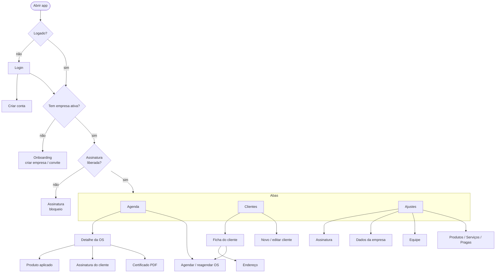

# Funcionalidades

## 1. Mapa de navegação

## 2. Permissões por papel

| Funcionalidade | Admin | Atendente | Técnico | Offline? |
|---|:-:|:-:|:-:|:-:|
| Ver agenda própria | ✅ | ✅ | ✅ | ✅ |
| Ver agenda de todos os técnicos | ✅ | ✅ | — | ✅ |
| Agendar OS | ✅ qualquer técnico | ✅ qualquer técnico | ✅ só para si | ✅ |
| Iniciar / atender / concluir OS | ✅ | ✅ | ✅ só as suas | ✅ |
| Gerar certificado | ✅ | ✅ | ✅ | ✅ |
| Cadastrar/editar clientes e endereços | ✅ | ✅ | ✅ | ✅ |
| Catálogos (produtos, serviços, pragas) | ✅ | ✅ | — | ✅ |
| Dados da empresa | ✅ | — | — | ❌ |
| Equipe (convite, papéis, remover) | ✅ | — | — | ❌ |
| Comprar / restaurar assinatura | ✅ | — | — | ❌ |
| Sincronizar, sair, excluir conta | ✅ | ✅ | ✅ | sair ✅ / excluir ❌ |

## 3. Telas

### Acesso

**Login** (`app/login.tsx`): e-mail e senha. O primeiro acesso precisa de internet,
depois o app abre logado mesmo offline. Os erros aparecem em português (credenciais
inválidas, e-mail não confirmado, sem conexão).

**Criar conta** (`app/cadastro.tsx`): nome, e-mail, senha (mín. 6) e confirmação. Se
o Supabase exigir confirmação de e-mail, avisa e volta para o login.

**Onboarding** (`app/onboarding.tsx`): aparece para quem não tem empresa ativa.
- *Sou o dono:* razão social (obrigatório), nome fantasia, CNPJ e telefone. Cria a
  empresa, a pessoa vira admin e ganha 14 dias grátis.
- *Tenho um convite:* código de 8 caracteres.
- Quem foi removido de uma equipe vê uma mensagem própria e pode criar ou entrar em
  outra empresa.

### Aba Agenda (`app/(tabs)/index.tsx`)

- Navegação dia a dia (setas), com atalho "voltar para hoje".
- Admin/atendente alternam entre **Minhas OS** e **Todos os técnicos**.
- No dia de hoje, mostra antes as **pendentes de dias anteriores** (agendadas ou em
  andamento).
- Cartão da OS: horário, status, cliente, endereço, serviço, número e técnico, mais o
  selo "pendente" quando ainda não foi sincronizada.
- Para o admin aparece a faixa de aviso quando faltam 5 dias ou menos de teste, ou na
  carência após o vencimento.
- Botão **+** para agendar uma OS.

### Ordem de serviço

**Agendar / reagendar** (`app/os/form.tsx`)
- Cliente (com atalho "+ Cadastrar novo cliente"), endereço (o primeiro é escolhido
  sozinho), serviço, técnico, data/hora (padrão: próxima hora cheia) e observações.
- Ao reagendar, o cliente fica travado.

**Detalhe / atendimento** (`app/os/[id].tsx`). A tela muda conforme o status:

| Status | O que aparece |
|---|---|
| Agendada | Dados da OS + **Iniciar atendimento**, **Reagendar/editar**, **Cancelar OS** |
| Em andamento | Pragas alvo (chips), produtos aplicados (+ Adicionar), relatório, recomendações, responsável no local, **Coletar assinatura**, **Concluir atendimento** |
| Concluída | Tudo só para leitura + **Gerar / enviar certificado (PDF)** e código do certificado |

Outros detalhes da tela:
- Toque no endereço abre o Google Maps, e toque no cliente abre a ficha.
- Os textos são gravados ao sair do campo (offline).
- Ao concluir, o app confere os obrigatórios (praga, responsável, assinatura). Depois
  pergunta se deseja enviar o certificado na hora.

**Produto aplicado** (`app/os/produto.tsx`, modal): produto (só os ativos),
quantidade (na unidade do produto, aceita vírgula), diluição, área aplicada e lote.
Permite editar e remover.

**Assinatura do cliente** (`app/os/assinatura.tsx`, tela cheia): quadro para assinar
com o dedo, com Limpar e Confirmar. Salva um PNG na OS.

**Certificado:** gera o PDF no aparelho e abre o compartilhamento (WhatsApp,
e-mail...). Conteúdo detalhado em [dominios.md](dominios.md#certificado).

### Aba Clientes

**Lista** (`app/(tabs)/clientes.tsx`): busca por nome, CPF/CNPJ ou telefone (até 300
resultados). Mostra o selo de pendente e o botão **+**.

**Novo / editar** (`app/cliente/form.tsx`): PF ou PJ, nome, documento, telefone,
e-mail, contato (PJ) e observações. No cadastro novo também pede o primeiro endereço.

**Ficha** (`app/cliente/[id].tsx`): dados com atalhos **Ligar** e **WhatsApp**,
lista de endereços (+ Adicionar), botão **Agendar ordem de serviço** e **histórico de
OS** do cliente.

**Endereço** (`app/local/form.tsx`): descrição, CEP, logradouro, número, complemento,
bairro, cidade, UF, tipo de imóvel e área (m²). Permite excluir o endereço.

### Aba Ajustes (`app/(tabs)/ajustes.tsx`)

- Empresa, usuário e papel, e-mail.
- Admin: **Assinatura**, **Dados da empresa**, **Equipe**.
- Admin/atendente: **Produtos**, **Serviços**, **Pragas**.
- **Sincronização:** online/offline, alterações aguardando envio, última sync, erro e
  botão "Sincronizar agora".
- **Sair:** se houver alterações não enviadas, avisa que serão perdidas.
- **Excluir minha conta**, exigência das lojas.

**Catálogos** (`app/catalogo/[tipo].tsx` e `form.tsx`): lista com ativos primeiro e
inativos esmaecidos, e formulário com os campos de cada catálogo mais a chave
**Ativo**. O catálogo de produtos avisa que os dados saem no certificado.

**Dados da empresa** (`app/empresa.tsx`, só admin, online): razão social, fantasia,
CNPJ, endereço, telefone, e-mail, licença sanitária, responsável técnico, registro do
RT e telefone de emergência toxicológica.

**Equipe** (`app/equipe.tsx`, só admin, online)
- Código de convite em destaque, **Compartilhar convite** (texto pronto com o passo a
  passo) e **Gerar novo código**.
- Membros com nome, e-mail e chips de papel (Técnico / Atendente / Admin), além de
  **Remover**.

**Assinatura** (`app/assinatura.tsx`)
- Situação: ativa até X (ou renovação cancelada), teste com N dias, carência ou vencida.
- Admin: planos do RevenueCat com preço e período, texto de renovação automática,
  **Restaurar compras** e **Gerenciar/cancelar na loja**.
- Não admin: orientação para pedir ao administrador.
- Links de termos e privacidade.
- Quando bloqueado: **Já assinei, verificar de novo** e **Sair**.

## 4. Indicadores de sincronização na interface

| Onde | O que mostra |
|---|---|
| Faixa no topo da Agenda e de Clientes | Offline (com nº de pendentes) · Sincronizando · Erro (toque para tentar) · N alterações aguardando envio |
| Selo "pendente" em cartões e itens | Registro alterado no aparelho e ainda não enviado |
| Número da OS | "OS (nº após sincronizar)" até a primeira sync |
| Ajustes → Sincronização | Detalhes e botão manual |

## 5. Fluxos principais

### Dono começando a usar
1. Cria a conta, depois escolhe **Sou o dono** e cria a empresa (14 dias de teste).
2. Ajustes → **Dados da empresa**: licença sanitária, RT, registro.
3. Ajustes → **Produtos**: cadastra os produtos com registro MS.
4. Ajustes → **Equipe** → compartilha o código de convite.

### Técnico no dia a dia
1. Abre a **Agenda**, que já vem com o dia de hoje e as pendentes.
2. Abre a OS e toca **Iniciar atendimento**.
3. Marca as pragas alvo, adiciona os produtos aplicados, escreve o relatório e as
   recomendações.
4. Preenche o responsável no local, coleta a assinatura e toca **Concluir**.
5. **Envia o certificado** pelo WhatsApp.

Tudo isso funciona sem internet, e sobe sozinho quando a conexão voltar.

### Atendente agendando
Clientes → busca ou cadastra o cliente → **Agendar ordem de serviço** → escolhe
serviço, técnico e horário.

## 6. Ainda não implementado

- Recuperação de senha ("esqueci minha senha")
- Fotos do atendimento (fila de upload para o Supabase Storage)
- Check-in com GPS ao iniciar o atendimento
- Painel web para o escritório (agenda em calendário, relatórios)
- Página pública de verificação do certificado + QR code no PDF
- Planos por número de técnicos
- OS recorrentes / contratos mensais; mapa de iscas para clientes PJ
